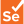

<!-- Ini image and text  -->

 
  

	How can we help each other? 😊

<!-- readme.md -->

🌱 Currently working in Data Engineering / Data Architecture.  
🪐 Exploring App Development.  
🤩 Expecting to grow and evolve in my knowledge.  
👯 I'm looking to collaborate in projects and share my personal learning path.  
⚡ Fun fact: love web 1.0 designs! 
🌎 PT | EN - 👓🎧🎙️ 
&nbsp;&nbsp;&nbsp;&nbsp;&nbsp;&nbsp;&nbsp;&nbsp;&nbsp;&nbsp;&nbsp;&nbsp;&nbsp;&nbsp;&nbsp;&nbsp;&nbsp;&nbsp;&nbsp;   
🌍 ES | IT | DE | FR - 👓

<!-- Contact me -->
<h3 align="center"> 📫 Contact me! </h3>

<table>
  <tr>
    <td align="center" width="64"></td>
    <td align="center" width="64"></td>
    <td align="center" width="64"></td>
  </tr>
</table>

<!-- Languages and Tools -->
<h3 align="center"> 🌌 Stack: </h3>

<table>
  <tr>
    <td align="center" width="64"></td>
    <td align="center" width="64"></td>
    <td align="center" width="64"></td>
    <td align="center" width="64"></td>
    <td align="center" width="64"></td>
    <td align="center" width="64"></td>
    <td align="center" width="64"></td>
    <td align="center" width="64"></td>
    <td align="center" width="64"></td>
  </tr>
  <tr>
    <td align="center" width="64"></td>
    <td align="center" width="64"></td>
    <td align="center" width="64"></td>
    <td align="center" width="64"></td>
    <td align="center" width="64"></td>
    <td align="center" width="64"></td>
    <td align="center" width="64"></td>
    <td align="center" width="64"></td>
    <td align="center" width="64"></td>
  </tr>
  <tr>
    <td align="center" width="64"></td>
    <td align="center" width="64"></td>
    <td align="center" width="64"></td>
    <td align="center" width="64"></td>
    <td align="center" width="64"></td>
    <td align="center" width="64"></td>
    <td align="center" width="64"></td>
    <td align="center" width="64"></td>
    <td align="center" width="64"></td>
  </tr>
  <tr>
    <td align="center" width="64"></td>
    <td align="center" width="64"></td>
    <td align="center" width="64"></td>
    <td align="center" width="64"></td>
    <td align="center" width="64"></td>
    <td align="center" width="64"></td>
    <td align="center" width="64"></td>
    <td align="center" width="64"></td>
    <td align="center" width="64"></td>
  </tr>
  <tr>
    <td align="center" width="64"></td>
    <td align="center" width="64"></td>
    <td align="center" width="64"></td>
    <td align="center" width="64"></td>
    <td align="center" width="64"></td>
    <td align="center" width="64"></td>
    <td align="center" width="64"></td>
    <td align="center" width="64"></td>
    <td align="center" width="64"></td>
  </tr>
  <tr>
    <td align="center" width="64"></td>
    <td align="center" width="64"></td>
    <td align="center" width="64"></td>
    <td align="center" width="64"></td>
    <td align="center" width="64"></td>
    <td align="center" width="64"></td>
    <td align="center" width="64"></td>
    <td align="center" width="64"></td>
    <td align="center" width="64"></td>
  </tr>
</table>

